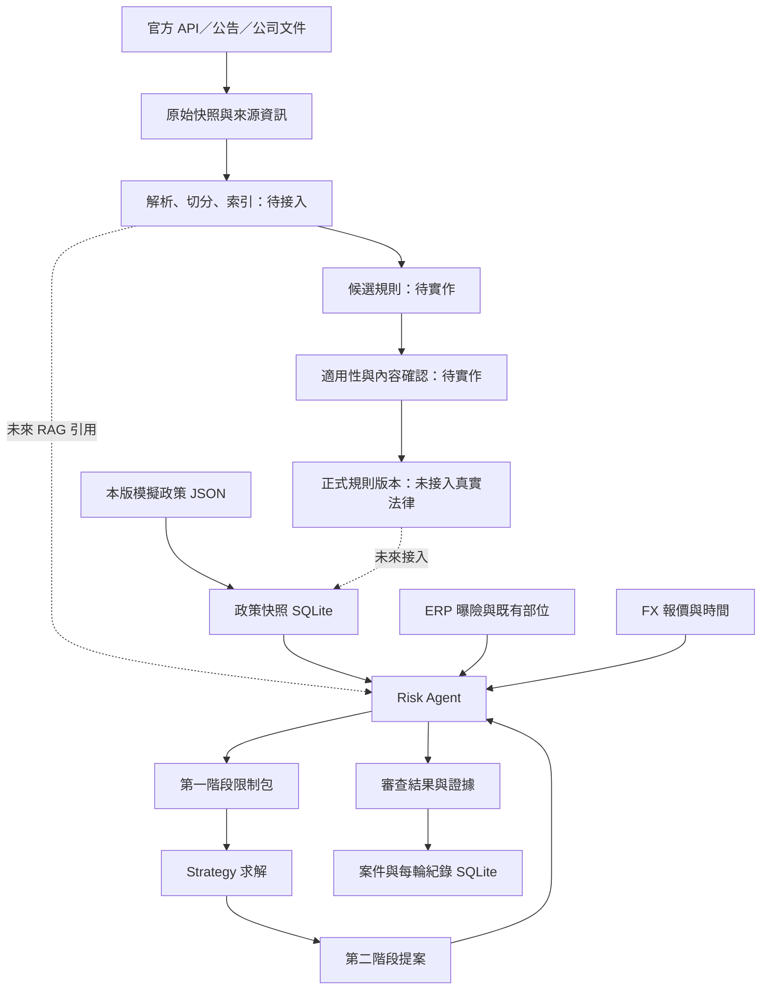
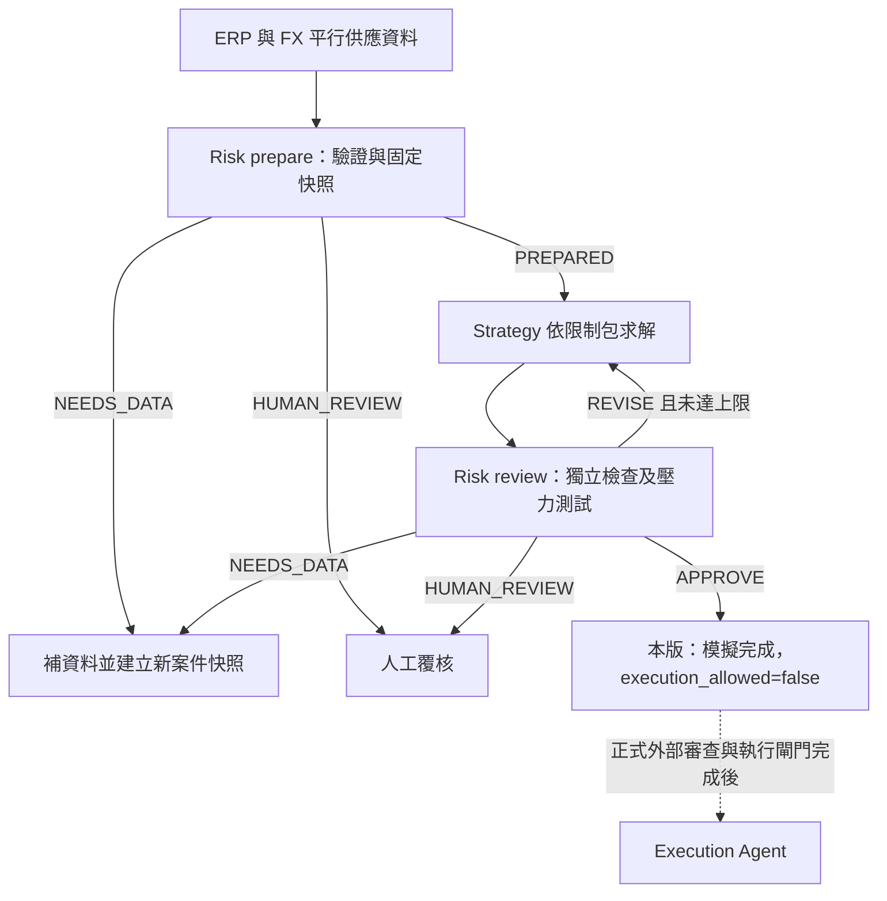

# 基本架構、資料流程與系統流程

## 目前交付邊界

此專案是作業用、可執行的 Risk Agent 基礎骨架。已完成兩階段控制與確定性工具；目前未呼叫 LLM、未自動解讀法律、未完成制裁／稅務／會計審查。`APPROVE` 只代表模擬政策與簡化情境測試通過，不能送銀行交易。

## 模組

| 模組 | 程式 | 責任與狀態 |
|---|---|---|
| 介面契約 | `schemas/`、`contracts.py` | 四種輸入／輸出驗證；拒絕缺欄、非法日期、未支援商品 |
| 案件控制 | `agent.py` | prepare、review、狀態路由、版本綁定與次數上限；已實作 |
| 風控工具 | `checks.py` | 時效、既有部位、方向、比例、遠期到期情境；已實作 |
| 記憶與版本 | `storage.py` | SQLite 保存政策全文、輸入與限制快照、每輪提案與結果；已實作 |
| 線上取得 | `ingestion.py` | SEC submissions 唯讀下載、雜湊與原始快照；其餘來源僅登錄 |
| 文件檢索 | `knowledge.py` | 本地文字關鍵字查找入口；尚未接到審查，未建向量索引 |
| LLM 推理 | `AgentPlanner` Protocol | 保留工具選擇介面，尚未接模型；不得繞過必要檢查 |

## 資料流程：慢速更新與逐案審查分開

RAG 尋找來源與說明；SQL 查詢正式規則，確定性工具執行數值檢查。檢索結果不是規則自動生效的依據。來源類別應區分公司揭露、內規、法律、稅務、會計與自願準則。

## 系統流程：同一個 Risk Agent 的兩種任務

不可把 `decision=APPROVE` 單獨當作銀行執行條件。未來正式執行還需驗證審查範圍、提案雜湊、核准期限、規則版本、最新制裁篩查及執行權限。

## 範例走一次

模擬美國法人 60 天後應付 EUR 3,000,000，既有 EUR 900,000 遠期。USD 為功能幣，spot=1.1 USD/EUR。公司模擬上限 80%，到期壓力損失上限 USD 80,000。

1. prepare 計算總名目本金上限 EUR 2,400,000，最多新增 EUR 1,500,000。
2. Strategy 第一版新增 EUR 1,800,000；Risk 算得總比例 90%，輸出 REVISE。
3. 第二版改新增 EUR 1,500,000，總比例 80%。
4. 假設既有與新增遠期匯率都是 1.1，新合約手續費 USD 1,000。EUR 上漲 10% 時，未避險曝險損失 330,000、遠期收益 264,000，合計損失含費用 67,000；低於 80,000。
5. 回傳 APPROVE / DEMO_POLICY_ONLY，execution_allowed=false；所有法律相關領域仍為 NOT_IMPLEMENTED。

這些數值是凍結時間的模擬案例，不是即時報價或 NVIDIA 部位。

## 狀態與錯誤處理

- 第一階段相同 case_id、相同輸入與政策可重送；內容改變必須使用新 case_id。
- 第二階段相同完整輸入重送會取得原審查紀錄，不增加次數。這是歷史結果重送，不是重新核准或延長有效期。
- 同一 proposal_id/version 不可改內容；重算需提高 version。只有 REVISE 案件可沿用快照繼續。
- 報價／曝險／政策或限制包失效，建立新案件；最多 3 次審查，第 3 次仍需重算就升級人工。
- Schema 錯誤、未知案件會以 ValueError／CLI 非零退出表示，不會生成核准。將來 HTTP 層可映射成 400／404。
- SQLite 原型以單程序串行使用；正式多工作者需交易鎖、任務佇列、授權與事件一致性控制。

## 如何接成完整 Agent

以 `case_id` 載入目標、案件狀態與證據，讓 LLM 在工具白名單中選擇補查、測試、重算或升級；控制層保留必要檢查與不可放寬的政策。參考 `agent_contract.md`。

RAG、排程器、LLM、外部 Agent 通訊不是此版已完成能力。現階段由 CLI／Python 函式觸發工具，路由是確定性的；保留完整 Agent 的接入邊界，避免把固定工作流誤稱為已完成的自主系統。
